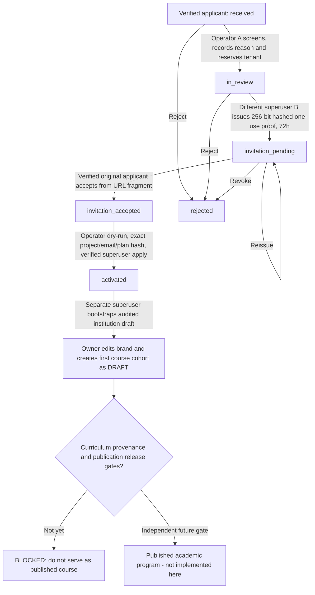

# LUMA — Institutional operator review, secure invitation, owner activation and first course

**Scope:** LUMA-073, first-client #55. **Deployment:** NOT APPROVED. Source under independent PR only. The procedure below has been verified exclusively with synthetic Firebase Auth/Firestore Emulators.

## Separation of duties and state machine



The applicant has **no authority** to select or grant admin roles, create privileged tenants or publish educational content. A platform superuser with a verified Firebase identity is required to review; a **different** superuser must issue the invite. Applicant UID/email must match the immutable application and signed Firebase ID token; bearer token entropy is 256 bits, hash-only at rest, constant-time compared and single-use. The link stores proof in its browser fragment (not HTTP query), removes it from browser address/history and temporarily holds it in session storage only if login is required. No external provider is authorized to receive that proof. The operator copies the one-time link using an approved channel; an automatic Microsoft/n8n mail dispatch is NOT integrated or represented as working.

All server writes use Firestore transactions, optimistic state preconditions and append-only audit receipts. Tenant IDs are reserved before invitation; slug collisions with existing draft/published config and other applications return 409. Reissue atomically rotates the digest; revoke makes it unusable and releases the reservation. A rejected or revoked invite can never grant roles. Returned bearer is only in the first successful authorized issue response; lost links must be reissued.

## Admin role operation: separate explicit trust boundary

Only a trusted operator with **Firebase Auth `superuser` claim, a signed and nonrevoked short-lived Firebase ID token for the exact declared UID, and authorized Admin SDK credentials** can execute `scripts/activate-first-academy.mjs` from an approved environment. Both activation and retention purge require the token in the ephemeral `LUMA_OPERATOR_ID_TOKEN` environment variable supplied by a trusted credentials broker or secure local session. The token is not accepted in positional CLI arguments or written to logs; a declared UID without a bound signed token is rejected. Treat the operator token as a secret and never paste it in a terminal command line, PR, artifact, browser URL, or chat. It checks accepted invitation state, two different reviewers, target enabled/verified Auth user, exact email and matching reserved tenant. It imports the existing validated `planTenantAdminClaims` helper and never creates an Auth user or superuser claim. The dry-run computes a SHA-256 plan bound to project, application, tenant, target UID/email, reviewers, operator and previous/next claims. The `--apply` command requires exact `--confirm-project`, `--confirm-email` and `--plan-sha`.

Before mutating Auth, the script creates one durable `institutionActivationIntents` record; a concurrent or repeated attempt refuses automatically. On a successful grant it revokes existing Firebase refresh tokens, updates the request to `activated`, marks the tenant reservation activated and writes audit events. This is **not a distributed transaction**: if Auth changes but audit finalization or token revocation fails, it fails closed and requires human reconciliation, never silent retry. The operator must not invent admin privileges for a different applicant.

**Operator example (illustrative placeholders, never paste real IDs or secrets into chat):**

```bash
node scripts/activate-first-academy.mjs \
  --project demo-luma-approval \
  --application-id 64_HEX_APPLICATION_ID \
  --operator-uid VERIFIED_PLATFORM_SUPERUSER_UID \
  --reason 'Documented identity and two-person institutional approval completed.'

# Both commands require LUMA_OPERATOR_ID_TOKEN from a secure short-lived
# credential source in the executing process environment; a UID flag alone
# is NOT authorization. Never hardcode or echo the token.
# Only after independent review of the dry-run report:
node scripts/activate-first-academy.mjs \
  --project demo-luma-approval --application-id 64_HEX_APPLICATION_ID \
  --operator-uid VERIFIED_PLATFORM_SUPERUSER_UID \
  --reason 'Documented identity and two-person institutional approval completed.' \
  --apply --confirm-project demo-luma-approval \
  --confirm-email verified-owner@example.test \
  --plan-sha REVIEWED_64_HEX_HASH
```

Once the role is applied, the owner must re-authenticate for a fresh Firebase ID token. Another authorized platform operator initializes the first draft with POST `/api/platform/institution-applications/{id}/bootstrap`; this uses the existing `FirestoreInstitutionDraftStore` and the previously reviewed `initialProgramId`. The new owner can edit draft brand/timezone-independent metadata and create the first course cohort through `/academia/primer-curso` without typing technical tenant IDs. **A cohort in status `draft` is not published learning content.** This deliberately does not bypass #57 authoring and publication review or #63 cohort evidence provenance.

## Security, abuse prevention, privacy retention

- Feature `LUMA_INSTITUTION_APPROVAL_ENABLED` defaults OFF. Independent `LUMA_INSTITUTION_REQUESTS_ENABLED` and `LUMA_INSTITUTION_DRAFT_ADMIN_ENABLED` must also be controlled. Do not enable any of these in production simply because an emulator test passed.
- All review routes require a verified unrevoked Firebase ID token with platform-superuser role; applicant accepting an invite has verified email and exact UID check. Cross-user access, impersonation, same-reviewer issuance, duplicate reservation, token replay, expired token and foreign-tenant role use are denied.
- `FirestoreInstitutionRequestThrottle`: 30 applicant submissions per verified UID per 15-minute window and 12 invitation validation attempts per verified UID per 15 minutes, with hashed identifiers, atomic counts and explicit HTTP 429. One immutable application per UID additionally blocks repeat submissions. This does **not** prevent many-account abuse: edge WAF/Cloud Armor, Firebase App Check, global traffic caps, quotas, recipient validation and alerting remain mandatory production P0.
- Applicant record retention is a **target** recorded in `retentionExpiresAt` (UTC ISO), not an automatic TTL promise: `received/in_review/invitation_pending/invitation_accepted` 90 days, `rejected` 30 days, `activated` 365 days with separate active-tenant retention. The `scripts/purge-academy-requests.mjs` tool defaults to dry-run and deletes only expired **unactivated** records on explicit platform-superuser command, `--apply --confirm-project`, and a separately enabled purge flag. It removes related invitations/reservations in one transaction and appends a non-email audit receipt. Accepted and activated applications are held pending a legally reviewed offboarding process; never auto-delete active identities or tenant records.
- The operator-bound retention tool also requires the same signed ID token. The current deletion tool is NOT scheduled and Firestore TTL is NOT configured. A governed execution cadence, deletion-request process, audit retention policy, App Check, edge abuse controls and review of PII in free-form operator reasons are outstanding. Do not assert data-protection regulatory compliance solely from these controls.

## Independent QA

Automated Next production-build HTTP suite `scripts/qa/first-client-approval-journey.mjs` (19 scenarios, including forged/missing operator token denials) exercises actual Firebase Auth/Firestore Emulator identities and role lifecycle. `evidence/first-client-approval-2026-10-18/api-results.json` contains the sanitized scenario receipt (no raw invitation token, password or Auth ID token). Admin role grant occurs only against the `demo-` emulator project; test users are removed and Firestore data discarded. Browser screenshots and axe/manual audit are separate gates.

**Release NO-GO:** despite proving the first admin can enter and prepare a cohort, publishing actual lessons, practices, questions and validated evidence is still blocked by #57 and #63. Do not merge, deploy, enable institutional flags or contact real applicants without explicit release approval and an independently reviewed production-like tenant test.
