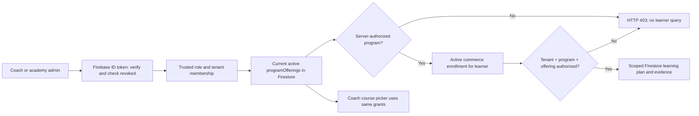

# LUMA — Institution, coach, offering and evidence authority (LUMA-072)

Status: **implementation verified in isolated branch; product release NO-GO**.
Original finding: GitHub issue #61. Base stacked branch: `fix/first-client-multi-course-selection-20261014` at `2328a8d147350113ca2ebf51c2bd4398ba0ab46b`.

## Client story

An academy administrator appoints an instructor to a premium live program. The instructor enters Studio, sees only authorized active courses, opens the permitted roster, inspects evidence and interventions, and cannot inspect another instructor's course. Removal of assignment revokes those reads immediately. The learner's own entitlements remain independent.

## Data flow and authorization

**The request header `x-luma-program-id` chooses a program but grants no access.** Browser storage and HTML hiding are not authorization. Tenant comes exclusively from trusted server deployment configuration. A fresh database lookup is performed per entitled coach HTTP read; no long-lived browser-only grant.

## Role and enrollment policy (same tenant)

| Identity | Course picker | Learner roster | Detail + evidence | Interventions |
|---|---|---|---|---|
| Guest or student without coach role | 401/403 | 401/403 | 401/403 | 401/403 |
| Coach with only `coachTenantIds` membership, no active offering assignment | No course | 403 | 403 | 403 |
| Coach assigned to **all current and historical cohorts** of a program | Program visible | Enrolled learners in assigned offerings | Same tenant/program/offering and active entitlement only | Authorized signals only |
| Coach removed from offering | Program disappears upon list refresh | 403 | 403 | 403 |
| Institution admin (`adminTenantIds`) | Every active offering in authorized tenant | Program roster | Active same-tenant/program learner evidence | Program signals |
| Platform superuser | All active offerings in deployment tenant | Scoped learner roster | Scope still requires active matching enrollment | Scoped signals |
| Foreign-tenant role | 403 | 403 | 403 | 403 |

**Cohort safety rule:** The Twin/evidence store currently keys by `tenantId + programId + learnerId`, not by `offeringId`. If a program has current or archived cohorts with different coaches, **no partially assigned course coach can read the program-wide Twin**, even if assigned one cohort. This is intentionally fail-closed to prevent cross-cohort disclosure. The institutional administrator retains authorized tenant-level oversight. True partial-cohort coaching will require cohort-scoped evidence storage, explicitly tracked as a separate capability (not silently enabled here).

Enrollment proof requires a valid active enrollment with matching `offeringId` for a regular instructor. Missing legacy `offeringId`, revoked/expired entitlements and foreign-tenant memberships are not sufficient. `coachLearnerIds` in legacy claims does not bypass the current published-program assignment policy.

## Reproducible QA

- Full 330 unit-test PASS, 81 configured SKIP, ESLint PASS and TypeScript PASS; webpack/Next.js 16.3.8 production build PASS in resource-controlled sandbox.
- Real Next HTTP routes, Firebase Auth and Firestore emulators with demo tenant; **15/15 PASS**, all temporary actor identities removed, emulator disposed.
- Baseline issue #61: same-tenant but unassigned coach could read evidence (`200`) while course picker returned zero options. Patch: `403` on detail, roster and interventions; program picker remains empty.
- Reassignment through the authorized admin offering management API grants the new teacher access and revokes the old teacher on the next request **without token refresh**.
- A second active cohort with a different coach denies both partial teachers, continues to allow the institution admin, and restores original coach access only after trusted administrators also assign the instructor to every historical cohort (archival alone is insufficient).
- No production data, permissions, tenants or records changed. This proof uses a configured pilot tenant, not a dynamic multi-tenant runtime.

Run: `JAVA_HOME=/opt/luma-jre21 firebase emulators:exec --project demo-luma-firstclient-20261014 --only firestore,auth 'bash scripts/qa/first-client-emulator-gate.sh'` from a dedicated disposable checkout after a verified local Next.js production build. The runner refuses a non-`demo-` project and a non-local emulator host.

## Tradeoffs and outstanding gates

- Tenant offering scan is bounded to 100; at 101 the service returns 409 fail-closed (GitHub #64). This is not an enterprise pagination solution. Before scale, introduce indexed/paginated tenant+program lookups and capacity tests.
- Current program-wide learning evidence cannot distinguish cohorts; do not promise offering-specific learner coaching until schema/persistence and migrations are audited.
- Coach selector refresh after reassignment may be manual until push invalidation exists; server authorization is immediate and authoritative.
- Showcase mode intentionally preserves its legacy demonstration semantics and must never be marketed as customer-isolated paid training.
- The institution onboarding (#55), verified tenant-owned published curriculum (#57), provider interoperability and manual WCAG/performance gates remain NO-GO. No release approval, merge or deploy.

## Protected CI gate

The `Product quality` workflow adds a `coach-rbac` job after the exact-release `verify` build. It downloads the preserved build artifact, runs all 16 synthetic first-client Auth/Firestore HTTP scenarios using pinned `firebase-tools@15.30.2` and Java 21, and uploads the sanitized results. The production deploy dependency includes `coach-rbac` alongside browser/identity/security/Firestore. This verifies the exact code that will ship and does not enable production deployment from a pull request.
