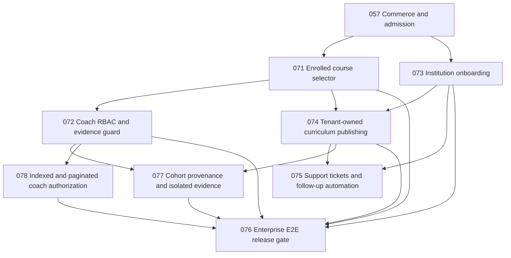

# First-client enterprise completion graph

Primary authority is `graph-harness.project.json` and its hash-linked append-only `graph-harness.events.jsonl`. Diagram below is a human-readable projection; node readiness is not production acceptance.

| Node | GitHub issue | Gate currently satisfied | Outstanding |
|---|---|---|---|
| LUMA-071 program selector | #56, draft PR #62 | PR #62 CI success and local authenticated Chromium and emulator QA | Review/merge and independent approved staging |
| LUMA-072 coach course authorization | #61 | Isolated implementation unit + HTTP emulator + build PASS | Stacked PR exact SHA CI and independent acceptance |
| LUMA-073 first institution onboarding | #55 | Verified unprivileged applicant intake: local 13 API + 8 Chromium PASS, 3 themes axe zero automatic violations; full QA CI gates added | Manual operator approval, institution/owner provisioning, abuse limits, invitation recovery and full academy E2E |
| LUMA-074 curriculum publication | #57 | Tracked in graph | Tenant-owned lessons, practice and rubric provenance |
| LUMA-075 tickets/automations | #58, #59 | Tracked in graph | Actual request handling and notifications |
| LUMA-076 final customer gate | #54 | Defined release dependencies | NO-GO pending prerequisites |
| LUMA-077 cohort evidence | #63 | Fail-closed interim read policy | Durable offering-scoped learning data and migrations |
| LUMA-078 scale | #64 | 101-offering negative test | Indexed/paginated auth and capacity |

Required release principle: no self-certification by the implementation agent. Graph evidence is a traceable review input, not a replacement for automated role denials, real user-journey QA, or human release approval. Current overall decision: **NO-GO**.
