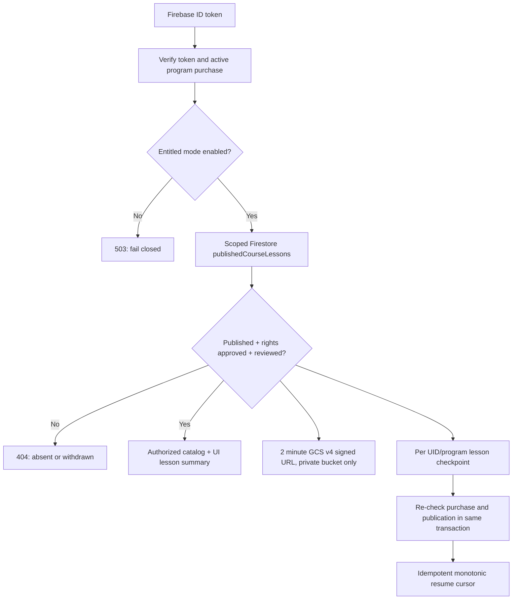

# LUMA — Authorized Course Delivery Kernel (technical slice)

**Date:** 2026-10-13. **Graph node:** `LUMA-CX-106-course-player` (partial implementation, NOT DONE). **Scope:** feature worktree `feat/learner-lifecycle-p0-20261013`, draft PR #51. **Publication status:** BLOCKED by actual licensed assets, content approval and staging media infrastructure.

## Learner experience (future user documentation)

An enrolled participant navigates to `/learn/course`. If their program has approved published lessons, they see **one next lesson** (or the earliest paused lesson), then a compact ordered list. A video exposes native media controls and records **reached position** about every 30 seconds and on pause/end. A PDF opens a temporary authorized link in a new tab, with **manually saved last-read page**. Learners can return via `/learn/course/[lessonId]` and resume from a different client without locally forged completion. Playback location and finishing a file are **consumption metadata, not demonstrated mastery, graded credentials, or certificate issuance**. UI and API give explicit empty, unauthenticated, no-purchase, unavailable and publication-pending states.

When no lesson has an institution-approved publication record, the page truthfully says **"Tu programa está en preparación"**. The seven source module covers remain editorial references; none is promoted to published lessons automatically. The existing `/learn/experiences` practice flow remains available. Release cannot imply an institution's syllabus is digitized before approval.

## Server-backed architecture

`src/lib/course-delivery.ts` owns the typed publication contract, conservative whitelist, Firestore scopes and checkpoint transactions; `src/lib/course-delivery-server.ts` owns the configured media signing adapter. Only `publishedCourseLessons` can enter a learner's catalog. Records must be `published`, rights `approved`, refer to a signed-off reviewer and rights record, have a source SHA-256, a valid publication window and media object under `courses/<hash(tenant)>/<hash(program)>/<lessonId>/v<revision>/...`. Draft, withdrawn, revoked, invalidly scoped and future-dated records are omitted or return 404. Firestore client access remains **deny-all** via `firestore.rules`, with access mediated by Next.js and Firebase Admin.

Premium endpoints:

| Route | Policy |
| --- | --- |
| `GET /api/learning/course` | Requires verified Firebase ID token + active commerce enrollment; returns only public lesson summaries and this learner's checkpoints, paginated |
| `GET /api/learning/course/[lessonId]` | Same verification; approved revision and scoped checkpoint |
| `POST /api/learning/course/[lessonId]/checkpoint` | Transaction re-reads active enrollment, exact lesson revision and current publication; idempotent, no regression by late writes |
| `GET /api/learning/course/[lessonId]/asset` | Re-authenticates, rechecks purchase and publication; signed short-lived private GCS URL or 503 when not authorized/configured |

The checkpoint path hashes tenant, program and Firebase UID; checkpoints are not globally shared or written by browser SDK rules. A video ending sets `status="reached_end"` for consumption **only**. Publishing cannot be performed from this API. A separate institutional editorial/admin scope and reviewed publication workflow must be implemented and verified before client media is onboarded.

### Deployment guardrails (do not set until authorized)

- `LUMA_LEARNING_ACCESS_MODE=entitled`; `LUMA_LEARNING_TENANT_ID=<approved tenant>`; `LUMA_LEARNING_PROGRAM_ID=<purchased program>` for a currently single-program deployment. Ambiguous multi-program entitlements fail closed until the learner selector exists.
- `LUMA_COURSE_MEDIA_BUCKET=<private institution-approved GCS bucket>`; `LUMA_COURSE_STORAGE_PRIVATE_CONFIRMED=true` **only after** IAM, public-access prevention, CORS/Range requests, signer identity, TTL and media rights are verified. No key JSON is uploaded or committed. The app signs URLs with an existing server-managed Google identity.
- A URL has a 120-second issuance TTL; the client supports a retry/refresh. Media revoked while a URL is outstanding can remain reachable until its expiry. For long videos and seeking, production requires validation of range-request renewal and adaptive streaming. Transcript, captions, localization and accessibility alternatives require institutional source files and manual quality checks.
- `showcase` deployment never returns premium lesson metadata or temporary media links. No current production asset has been uploaded by this implementation.

## Verifier evidence

**Synthetic isolated Auth/Firestore/Next/Playwright E2E: 12/12 PASS.** This simulates authorized Jeremy and Abigail, unentitled Julian, two fictitious published resources (video, PDF), draft/revoked resources, stale checkpoint, other-user lookup, media signing refusal, separate browser identity and post-refund authorization denial. Credentials and content are fictitious; signed GCS media is deliberately unavailable. Browser QA bridge is located only in the **separate QA worktree** `/workspace/projects/LUMA-learner-p0-retest-20261013`; never copy it to the deployed repository.

`npm run lint` and `npm run typecheck` PASS; **320 unit tests pass (85 skipped)**; full Firestore integration **54 PASS** including 3 course-specific checks; optimized Next.js Webpack build PASS; browser guest contract **7 PASS (1 skipped)** across desktop/mobile on the optimized build. Receipts: `evidence/learner-lifecycle-20261013/course-delivery-synthetic-e2e.json` and `course-delivery-quality.json`. `e2e/course-delivery.spec.ts` is CI-native; `src/lib/course-delivery.emulator.test.ts` has been added to the existing Firestore CI job.

## Pending acceptance — release NO-GO

1. Institution-approved lesson manifest with per-asset rights and publication receipts, real accessible video/PDF/transcript data (no pretend class inventory).
2. Scoped editorial publisher API with human approval, withdrawal and audit trail; proof that the GCS asset's hash matches the approved source.
3. Private GCS signing permissions and a real video playback/seek/re-signing smoke, mobile Safari, captions and transcripts; test revoked access after active streaming starts.
4. UX for participants with **multiple simultaneous purchases** and exact offering/cohort mapping. The current single-program selector fails closed when ambiguous.
5. Manual assistive-technology, a11y/WCAG and field p75 CWV, genuine Hotmart/Google staging and instructor acceptance, plus full documentary completion requirements.
6. Release verification on the exact GitHub Actions PR SHA, then explicit human merge and deploy approval.

**Decision:** the technical *lesson-delivery foundation* has synthetic QA evidence. The overall `LUMA-CX-106` and enterprise `LUMA-CX-107` gates remain **BLOCKED**, not green. No changes to production, IAM, Hotmart live webhooks or customer media were made.

## 2026-10-19 — Adversarial experience hardening

The release is still **NO-GO**. The course infrastructure has been revalidated with **15/15 isolated synthetic Auth/Firestore/Playwright checks** after warming new Next.js development routes. This run confirms the active enrollment links to **Mis lecciones**, Jeremy's checkpoint cannot appear for Abigail in the same mounted view, nonbuyers and revoked buyers cannot access content, and the next authorized action sits above the fold on desktop **1440×900** and mobile **390×844**. Automated WCAG 2.1 AA checks returned zero violations on the authenticated mobile course catalog; **manual assistive-technology assessment is still needed**. No actual media playback occurred.

The critic caught two regressions and recorded a repair: numeric indexes in the mobile navigation initially displaced the tutor link LUMA after Lecciones was added; the primary items now use stable route selection. Also, more than one page of unpublished/draft lesson records could mask later approved lessons; the course store now scans in bounded batches and the QA fixture inserts **55 unapproved drafts** before 2 valid lesson receipts. Neither drafts nor revoked material appears in the learner catalog.

A cold-route test in the shared container previously recorded **10/12** after Next.js waited 66 seconds to compile and Chromium crashed. The failing run is not disguised as a pass; the subsequent repeat was made reproducible by prewarming only the local QA server's routes, not weakening authorization checks or adding demo-only browser code to production. The 2026-10-19 record and mobile/desktop synthetic screenshots are under evidence/learner-lifecycle-20261013/course-delivery-*20261019.*; these are **not production UX captures**.

The learner design keeps one clearly labeled primary action and separates content-consumption checkpoints from rubric-scored evidence. Publication rights, captions, private GCS media delivery, multiple-purchase selection and instructor-approved lesson inventory remain blocked external/product gates.
