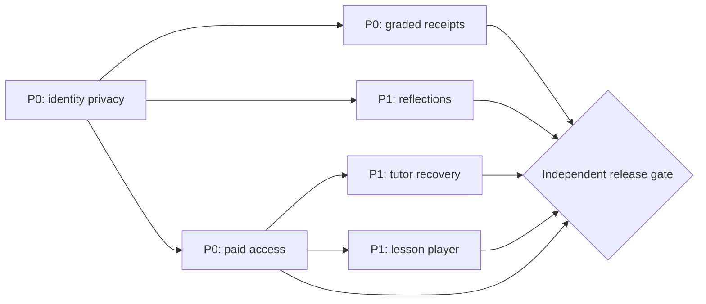

# LUMA / Graph Engineering — Learner Lifecycle Hardening

**Date:** 2026-10-13. **Mode:** SHIP. **Baseline:** `main@7ef32ba9`. **Scope:** issues [#46](https://github.com/BernydotJar/LUMA/issues/46), [#47](https://github.com/BernydotJar/LUMA/issues/47), [#48](https://github.com/BernydotJar/LUMA/issues/48), [#49](https://github.com/BernydotJar/LUMA/issues/49).

## Executable graph

`graph-harness.learner-lifecycle.project.json` describes seven typed nodes, dependencies, allowed paths and independent quality gates; events live in the adjacent append-only `graph-harness.learner-lifecycle.events.jsonl` chain. The pinned Graph Harness runtime is `/workspace/_shared/Graph-harness-sdlc` in Cloud Sandbox; CI can install it from a pinned repository revision instead of depending on a workstation path.

**Producer → Critic → Fixer → Independent Verifier → Release Gate → Evidence**. Every FAIL must create a localized issue and regression; a passed TypeScript build alone cannot close a node. Do not record a gate as PASS unless the exact SHA has independently repeatable evidence. Commits, merges, credentials and deployment remain distinct human-gated actions.

## Findings, root cause and decisions

| Priority | Gap | Design decision | Acceptance |
| --- | --- | --- | --- |
| **P0** | Same-device account switch leaks goal and PAS rubric | Never hydrate an authenticated learner from legacy or guest-local keys. Clear unowned keys on identity changes. Secure server records are scoped by UID, tenant and program. | Jeremy logs out, Abigail logs in: no Jeremy content or legacy keys; vice versa and anonymous preview. |
| **P0** | Older PAS grade disappears behind newer reflection / different device | `GET /api/learning/plan` supplies the most recent **scored** rubric from the authenticated program's event ledger; reflection cannot replace it. | 3/3 rubric visible after multiple reflections, new browser; revocation denies. |
| **P1** | Reflection disappears after browser restart | Persist auto-report separately in Firestore under learner+course and read by signed-in owner. Never increment graded mastery. | Adán reflects, signs into another browser, sees same text and `self-reported` state. |
| **P0** | User doesn't know what course was purchased; public practice vs paid is ambiguous | `/api/commerce/access` claims only by verified Firebase email. UI marks active course or public demo. Public samples are explicitly unaudited previews; exclusive course lessons require new server entitlement gate. | Guest sees preview copy; paid user sees purchased program and one next step; nonbuyer doesn't see an active enrollment. |
| **P1** | Tutor with unavailable RAG gives no next action | Show retry and truthful link to cohort session. Don't fabricate a coach chat, email or retrieved source. | Tutor HTTP503 shows status, retry and published session link. |
| **P1** | Seven covers are not seven completed lessons | Authoritative published lesson asset inventory, signed delivery and durable lesson checkpoint are required; prohibit using generic teaser cards to certify completion. | Learner completes/resumes approved lesson across devices; instructor controls publication. |
| **Release** | Only emulator-based commercial/SSO tests | Stage genuine provider webhook, Google OAuth, LiveKit, accessibility, CWV, independent test actors and approved content. | All SHIP gates pass, human approval before deployment. |

## Invariants

- No personal rubric or reflection is read from a storage key lacking verifiable authenticated ownership. Legacy keys are **deleted rather than migrated** because their original owner is unknown.
- Guest practice is a **public sample** and cannot generate accredited course progress or a signed certificate.
- The server must verify Firebase identity, effective enrollment, tenant and program on read/write. Client labels do not replace server authorization.
- Grades and self-reports are different event classes with different academic meaning and persistence.
- The interface makes server failures visible; it cannot represent an unconfirmed local attempt as persisted.
- Test-only Auth Emulator browser bridges **must not be deployed**. Run browser QA in a separate isolated worktree, not in production.

## Evidence and status

See `evidence/learner-lifecycle-20261013/`. Release is **NO-GO until all gates are proven**. It is legitimate for implemented tasks to be in `review` while content, integrations, quality, security or explicit human acceptance are blocked. Document blocked dependencies rather than declaring the product finished.

## Validated graph projection — 2026-10-13

The typed append-only event chain contains **43 checksum-linked events** (implementation evidence, test/security/critic reviews, transitions and one checkpoint). `graph-harness ... validate` must pass in CI.

| Node | Status | Gate summary |
| --- | --- | --- |
| LUMA-CX-101 identity isolation | **DONE** | Synthetic independent QA, security + critic evidence |
| LUMA-CX-102 graded receipts | **DONE** | Firestore + browser, evidence-review PASS |
| LUMA-CX-103 self-reported reflections | **DONE** | Scoped read/write, security-review PASS |
| LUMA-CX-104 purchased-course disclosure and public samples | **DONE** | Access API 403, browser state, security-review PASS |
| LUMA-CX-105 tutor unavailable recovery | **DONE** | Browser retry/agenda tests, evidence-review PASS |
| LUMA-CX-106 full course player and published lessons | **BLOCKED** | Real approved curricular media/rights/manifests not present |
| LUMA-CX-107 enterprise release | **NOT AUTHORIZED; RELEASE GATE BLOCKED** | E2E from real providers, manual checks, content, human signoff outstanding |

These `DONE` markers mean *narrow implementation quality with synthetic QA*, not that the full enterprise product is releasable or that an independent external human has certified it. The original NO-GO for a complete program still applies.

## Graph recovery after real CI failures — checkpoint 2026-10-13

**Do not overwrite the original 43-event QA snapshot.** The append-only log now contains **86 verified events**. The subsequent events preserve two CI-discovered defects, descendant invalidations, localized repair work and evidence-based gate reinstatement:

| CI execution | Finding and action | Result |
| --- | --- | --- |
| PR #51 run `38460562978` | Firestore serializer rejected optional `lastScoredEvidence: undefined`; invalidate scored-receipts node and release descendants, then repair serializer and test real 51-stateful suite | Repair implemented; full six-suite Firestore Emulator 51/51 PASS |
| PR #51 run `38462477308` | Browser failure from two guest "Acceder" accessible names; invalidate course-access node and dependent tutor recovery, add distinct "Iniciar sesión" CTA and browser test | Targeted desktop/mobile 5 pass, 1 skipped |
| PR #51 run `38463504207`, SHA `6c77cb6059653f614391f9a07211553b6cf9e73d` | `verify`, `security`, `identity-roles`, `firestore` and full `browser` all succeeded; browser **125 PASS, 7 skipped, 0 fail** | Five QA feature nodes **DONE** again; release **NO-GO**; deploy job skipped |

Root-cause and exact-SHA execution evidence: `evidence/learner-lifecycle-20261013/adversarial-critic-postfix.json`, `auth-cta-postfix.json`, `firestore-full-postfix.json` and `github-ci-verified.json`. This is a deterministic automated quality closure; **not** human approval or a field production reliability certification. Pending offline results now bind to a server-confirmed UID/tenant/program, avoiding cross-program replay. The seven source files referenced by the program module catalog are accessible in Google Drive metadata (six PDF and one DOCX), but publication rights and actual lesson delivery are not approved.

**Remaining:** LUMA-CX-106 PUBLISHED LESSON PLAYER / LICENSED ASSETS / SECURE DELIVERY / DURABLE RESUME is BLOCKED. LUMA-CX-107 ENTERPRISE RELEASE is BLOCKED until content, genuine provider staging, accessibility/performance and human/customer signoff. Do not merge this draft PR or deploy because these product-level gates are not finished. The next doc-only commit may trigger a new PR CI SHA; the preceding pass applies to the exact audited implementation tree, and new SHA must be monitored independently.

## LUMA-CX-106 implementation slice — 2026-10-13

The protected lesson-delivery **kernel** has been added on the PR branch without publishing customer media: `src/lib/course-delivery.ts`, `src/app/api/learning/course/**`, `src/app/learn/course/**`, and `src/components/course-lesson-*`. It supports signed URL issuance only after entitlements and reviewed content; no signed URLs are issued unless private GCS is explicitly configured. The learner's checkpoint is transactionally protected and independent of academic rubric/certification signals. Sources remain unpublished. The Graph Harness project now permits these paths under node `LUMA-CX-106`, while retaining the node's **content-approval** gate.

Synthetic evidence: **12/12 real local Next/Auth/Firestore/Playwright scenarios** plus **54/54 Firestore Emulator** and 7/7 targeted desktop/mobile browser checks (1 skip) and **320 unit PASS** (85 skipped). These are **implementation quality checks**, not institutional content acceptance. Full on-SHA GitHub CI and actual GCS/instructor review are pending at the point of initial documentation. See `COURSE_DELIVERY_KERNEL_20261013.md` for accepted contract and blocking production inputs. **Do not promote `LUMA-CX-106` or `LUMA-CX-107` to DONE.**

## 2026-10-19 — Course delivery implementation quality

The implementation slice for LUMA-CX-106 has advanced: a scoped catalog, a learner-facing next/continue lesson, privacy-safe temporary media-signing endpoint, Firestore transaction-backed playback/document checkpoints, explicit empty/unavailable states, and improved mobile navigation exist on the review branch. Neither actual institutional media nor an approved publisher workflow exists; the node's institutional **content-approval gate remains BLOCKED**.

The adversarial browser run verified **15/15** synthetic scenarios, including mobile/desktop above-the-fold primary action, WCAG 2.1 AA automated checks with zero issues on the authenticated catalog, a 55-draft starvation challenge, account-switch isolation and refund denial. Full source tree local quality: **320 unit PASS, 85 skipped**; **54/54 stateful Firestore Emulator PASS**; **7 Chromium/mobile guest PASS, 1 skipped**; TypeScript, ESLint and optimized Webpack build PASS. See evidence/learner-lifecycle-20261013/course-delivery-quality.json and course-delivery-critic-20261019.json. These checks use synthetic data, not real payments, actual media playback or manual customer acceptance.

The independent CI on the new PR commit is still required for the exact modified implementation tree. Keep five earlier learner capability nodes DONE, LUMA-CX-106 BLOCKED on content/publication, and LUMA-CX-107 BLOCKED on enterprise release until actual staging and signoff. Do not merge or deploy the draft merely because this technical slice passed.
