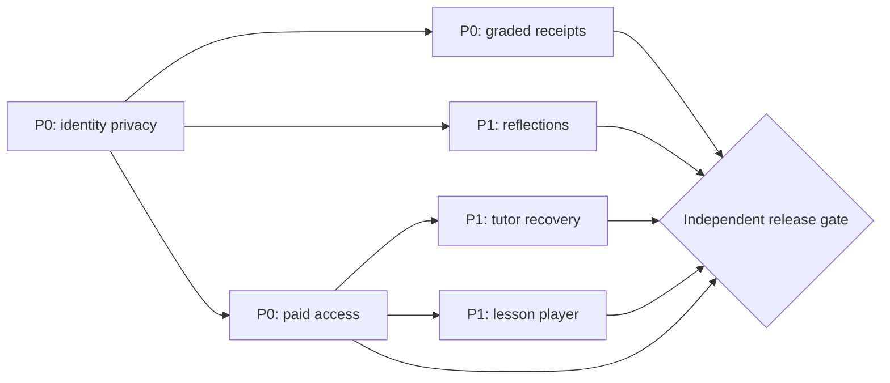

# LUMA / Graph Engineering — Learner Lifecycle Hardening

**Date:** 2026-10-13. **Mode:** SHIP. **Baseline:** `main@7ef32ba9`. **Scope:** issues [#46](https://github.com/BernydotJar/LUMA/issues/46), [#47](https://github.com/BernydotJar/LUMA/issues/47), [#48](https://github.com/BernydotJar/LUMA/issues/48), [#49](https://github.com/BernydotJar/LUMA/issues/49).

## Executable graph

`graph-harness.learner-lifecycle.project.json` describes seven typed nodes, dependencies, allowed paths and independent quality gates; events live in the adjacent append-only `graph-harness.learner-lifecycle.events.jsonl` chain. The pinned Graph Harness runtime is `/workspace/_shared/Graph-harness-sdlc` in Cloud Sandbox; CI can install it from a pinned repository revision instead of depending on a workstation path.

**Producer → Critic → Fixer → Independent Verifier → Release Gate → Evidence**. Every FAIL must create a localized issue and regression; a passed TypeScript build alone cannot close a node. Do not record a gate as PASS unless the exact SHA has independently repeatable evidence. Commits, merges, credentials and deployment remain distinct human-gated actions.

## Findings, root cause and decisions

| Priority | Gap | Design decision | Acceptance |
| --- | --- | --- | --- |
| **P0** | Same-device account switch leaks goal and PAS rubric | Never hydrate an authenticated learner from legacy or guest-local keys. Clear unowned keys on identity changes. Secure server records are scoped by UID, tenant and program. | Jeremy logs out, Abigail logs in: no Jeremy content or legacy keys; vice versa and anonymous preview. |
| **P0** | Older PAS grade disappears behind newer reflection / different device | `GET /api/learning/plan` supplies the most recent **scored** rubric from the authenticated program's event ledger; reflection cannot replace it. | 3/3 rubric visible after multiple reflections, new browser; revocation denies. |
| **P1** | Reflection disappears after browser restart | Persist auto-report separately in Firestore under learner+course and read by signed-in owner. Never increment graded mastery. | Adán reflects, signs into another browser, sees same text and `self-reported` state. |
| **P0** | User doesn't know what course was purchased; public practice vs paid is ambiguous | `/api/commerce/access` claims only by verified Firebase email. UI marks active course or public demo. Public samples are explicitly unaudited previews; exclusive course lessons require new server entitlement gate. | Guest sees preview copy; paid user sees purchased program and one next step; nonbuyer doesn't see an active enrollment. |
| **P1** | Tutor with unavailable RAG gives no next action | Show retry and truthful link to cohort session. Don't fabricate a coach chat, email or retrieved source. | Tutor HTTP503 shows status, retry and published session link. |
| **P1** | Seven covers are not seven completed lessons | Authoritative published lesson asset inventory, signed delivery and durable lesson checkpoint are required; prohibit using generic teaser cards to certify completion. | Learner completes/resumes approved lesson across devices; instructor controls publication. |
| **Release** | Only emulator-based commercial/SSO tests | Stage genuine provider webhook, Google OAuth, LiveKit, accessibility, CWV, independent test actors and approved content. | All SHIP gates pass, human approval before deployment. |

## Invariants

- No personal rubric or reflection is read from a storage key lacking verifiable authenticated ownership. Legacy keys are **deleted rather than migrated** because their original owner is unknown.
- Guest practice is a **public sample** and cannot generate accredited course progress or a signed certificate.
- The server must verify Firebase identity, effective enrollment, tenant and program on read/write. Client labels do not replace server authorization.
- Grades and self-reports are different event classes with different academic meaning and persistence.
- The interface makes server failures visible; it cannot represent an unconfirmed local attempt as persisted.
- Test-only Auth Emulator browser bridges **must not be deployed**. Run browser QA in a separate isolated worktree, not in production.

## Evidence and status

See `evidence/learner-lifecycle-20261013/`. Release is **NO-GO until all gates are proven**. It is legitimate for implemented tasks to be in `review` while content, integrations, quality, security or explicit human acceptance are blocked. Document blocked dependencies rather than declaring the product finished.
